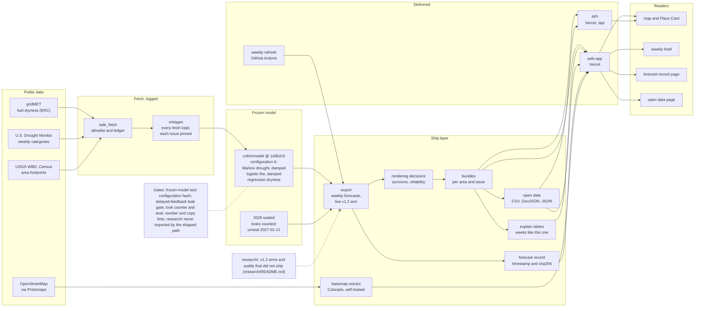

# COFIRE

## For reviewers

COFIRE gives calibrated odds of drought and of the conditions that let fire spread, 2 to 8 weeks ahead, for every 4 km of Denver, the two mountain watersheds its water comes from, and Larimer and Pueblo counties. Its model was frozen and its tests written down before the held-out year was opened, every look at that year is counted, and where a result failed (the forecast ranges) the app says so and shows nothing.

**Run it (no keys, no network):** `make setup && make demo`, then open http://127.0.0.1:3000.

| Where | What |
|---|---|
| [`cofire/model/`](cofire/model/) | The frozen model at `FREEZE_COMMIT` (configuration A: Markov drought, damped-persistence logistic fire, damped regression dryness), hash-checked |
| [`cofire/ship/`](cofire/ship/), [`cofire/v12/`](cofire/v12/), [`cofire/v13/`](cofire/v13/) | The shipped path: fetch and vintages, weekly export, rendering decisions, bundles, explanations, open data, the forecast record |
| [`app/`](app/) | The Next.js app: prerendered pages reading the forecasts as static files, and an API (`cofire/deploy/`) for Predict and Observe |
| [`tests/`](tests/), [`app/e2e/`](app/e2e/) | Python tests and browser tests |
| Gates | [`tests/test_frozen_model.py`](tests/test_frozen_model.py) (configuration hash), [`tests/test_delayed_feedback_gate.py`](tests/test_delayed_feedback_gate.py) (no update uses the future), [`tests/test_shipped_path.py`](tests/test_shipped_path.py) (research never ships; shipped code documented), [`scripts/check_stats.py`](scripts/check_stats.py) and [`scripts/check_copy.py`](scripts/check_copy.py) (no hard-coded numbers, no overclaiming) |
| [`research/`](research/) | What was tried and does not ship, and why |
| [`film/`](film/) | The demo film, built in code: script, storyboard, sources, licenses |

- **Preregistrations:** [`docs/PREREGISTRATION_V1.md`](docs/PREREGISTRATION_V1.md), [`docs/PREREGISTRATION.md`](docs/PREREGISTRATION.md), [`docs/PREREGISTRATION_LOOK3.md`](docs/PREREGISTRATION_LOOK3.md), [`docs/PREREGISTRATION_V12.md`](docs/PREREGISTRATION_V12.md), [`docs/PREREGISTRATION_CALIBRATION.md`](docs/PREREGISTRATION_CALIBRATION.md).
- **Corrections:** [`docs/CORRECTION_LOOK3.md`](docs/CORRECTION_LOOK3.md) (the interval results are void), [`docs/LEAK_SWEEP.md`](docs/LEAK_SWEEP.md), and the corrections in [`STATUS.md`](STATUS.md).
- **Every decision, with its reasons:** [`docs/DECISIONS.md`](docs/DECISIONS.md).
- **Who wrote what:** [`AI_USAGE.md`](AI_USAGE.md).
- **The film:** [`film/README.md`](film/README.md) and [`film/SCRIPT.md`](film/SCRIPT.md).
- **Open data:** CC BY 4.0, on the app's Open data page.

### Architecture

<!-- architecture:begin -->



The same diagram as an image: [docs/architecture.svg](docs/architecture.svg) (generated by `scripts/architecture.py`).

<!-- architecture:end -->


Colorado Fire Intelligence and Risk Engine. 2026 Congressional App Challenge.

COFIRE forecasts **drought** and **conditions that allow fires to spread** 2 to 8 weeks ahead at gridMET 4 km cells, for five areas: the **City and County of Denver** (all of CO-01, Glendale and Holly Hills enclaves included), the two watersheds Denver Water collects from (the **Upper South Platte above Strontia Springs** and the **Blue River above Dillon**), and **Larimer** and **Pueblo** counties. It says which numbers it can stand behind, and turns the result into a decision: predict (Beat the Model), observe (Observer Streaks), and prepare (the Urban Ember Score for Denver, the wildland-edge Ember Score elsewhere).

It does **not** predict ignitions or where a fire will occur.

### What COFIRE claims, and what it does not

- **Skill** is claimed for 22 of 115 target and area pairs, the ones that beat their baseline after multiplicity control across all five areas and a shuffled-target check, with training labels kept out of the evaluation period. Nowhere else. 12 are in Larimer and Pueblo and 10 in Denver and its watersheds. One of the 12, Pueblo drought reaching D2 in 4 weeks, was withdrawn by the leak-free refit and restored when a missing drought map (2022-12-27) was fixed; see [`docs/LEAK_SWEEP.md`](docs/LEAK_SWEEP.md) and `STATUS.md`. No target holds in every area where it can be tested, so every claim is for its own area only.
- **Probabilities** for Larimer and Pueblo were tested once on the sealed 2026 year against pre-registered criteria: 39 of 54 passed reliability. Denver and its watersheds were added after the seal and are never scored on 2026; their probabilities were checked on 2022 to 2023 with the same threshold. Where a target failed or could not be checked, the app shows no per-cell number and says why: a fire target shows the area's usual rate for the season, and a drought target shows no number, because a historical rate beside the model's other drought odds could contradict them on one card.
- **Forecast ranges are not shown.** The pre-registered interval tests passed, but the test was flawed: it updated each forecast with outcomes from the same week, which a real forecast would not know for 2 to 8 weeks. Run with the real delay, the method is unstable. The results are void and the app draws no band. See [`docs/CORRECTION_LOOK3.md`](docs/CORRECTION_LOOK3.md), beside the unedited [`docs/PREREGISTRATION_LOOK3.md`](docs/PREREGISTRATION_LOOK3.md), and the follow-up sweep for the same class of fault in [`docs/LEAK_SWEEP.md`](docs/LEAK_SWEEP.md).

## Run

```bash
git clone <this-repo> && cd cofire
make setup   # uv sync --extra dev --extra pipeline + npm install
make demo    # offline: no API keys, no network, no pipeline run
```

Then open http://127.0.0.1:3000 (API on :8000).

`make demo` serves the committed fixture set in `demo/`: two issues of forecasts for all five
areas as per-domain bundles, and the look-3 and survivor tables the Hindcast and Method screens
read. **Measured clone-to-running: 26 seconds** on 2026-09-27 with warm uv and npm caches (`make setup` 4 s, both servers answering 22 s later), from a fresh clone with no `data/`; every route then passed for every area (Playwright, 54 tests).

Regenerate the fixture after a pipeline run with `make demo-data`.

Then open http://127.0.0.1:3000 (API on :8000). The Larimer County vertical slice should finish on a laptop with network in under 45 minutes. Statewide is **staged and gated** (see `make statewide` for the plan and per-stage ETA); it is not
started while `STATUS.md` reads No-go.

Core pipeline needs **zero API keys**. Optional Earthdata / Synoptic keys are listed in `.env.example` and skipped when blank.

## Deploying (Vercel)

One Vercel project with two services (`vercel.json`), on one domain:

| Service | What | Public at |
|---|---|---|
| `web` | the Next.js app (`app/`); the map reads the forecast bundles as static files under `/data` | `/` |
| `api` | the FastAPI service (`cofire/deploy/vercel_app.py`): Predict picks, Observe reports, leaderboard, Ember | `/api` |

`api` reads the forecast cells it checks picks against from `web`'s published
bundles, through a binding (`WEB_URL`, injected by Vercel). Leave the
dashboard's build settings at their defaults; `vercel.json` holds them.

1. **A token for the basemap.** The 51 MB map extract is a release asset of
   this private repository. Create a fine-grained GitHub token limited to
   this repository, with **Contents: Read-only** and no other permission.
2. **Import the project.** In Vercel: Add New, Project, import this
   repository, root directory at the top of the repository.
3. **Add a Postgres database** from the project's Storage tab (Neon has a
   free tier). It sets `DATABASE_URL` for the project; the API uses it for
   picks and reports. Without one, they are kept only while a function
   instance lives, and `/api/health` says `"storage": "temporary"`.
4. **Set the variable** `COFIRE_RELEASE_TOKEN` (the token) for Production,
   and for Preview if previews should show the map. A production build
   without it stops with an error.
5. **Deploy, then check:**
   `python scripts/check_deploy.py https://<your-project>.vercel.app/`. It
   checks the pages, the bundles, the basemap's byte-range requests, the
   404 page, and that `/api` answers with Postgres storage.
6. **Point the checks at it.** Set the repository variable `SITE_URL` to the
   address; the daily smoke run then checks the live site. Set `site_url`
   in `film/config.json` too, then re-render the film's end card.

**Python dependencies.** The project's own dependencies are what the API
needs at run time, so Vercel's install for `api` stays near 160 MB, under
the 500 MB function limit. The pipeline, the model and the static build
need the `pipeline` extra (`make setup`, or
`uv sync --extra dev --extra pipeline`). CI's `api-slim` job runs the entry
point on the slim set alone (`scripts/check_api_slim.py`). Vercel offers
Python 3.12 and later only, so both services build on 3.12; local runs and
CI keep the 3.11 in `.python-version`. The web build installs the `site`
extra (geopandas, pyarrow), not the whole pipeline.

**If the API cannot read the bundles** (the check's leaderboard line
fails), set `COFIRE_BUNDLES_URL` to the site's public
`https://<domain>/data/domains/` in the project's environment variables.

The weekly refresh commits as its own bot. If Vercel skips those commits
(on the Hobby plan, a private repository's commits by an author outside the
Vercel account can be blocked), make a Deploy Hook for `main` in the
project's Git settings and save its URL as the repository secret
`VERCEL_DEPLOY_HOOK`; the refresh calls it after each push.

## What you get

- Map of forecast cells and a Place Card per cell: point forecast, per-cell probabilities where they held up, and the county rate where they did not
- Hindcast: the look-3 results against each pre-registered criterion, with the interval correction first
- Beat the Model, Observer Streaks, Ember Score against SQLite
- `artifacts/metrics.md`, PI-ConvLSTM ablation (no penalties / hydro / both)

Shipping resolution is **4 km**. 10–30 m HLS downscaling is off unless `COFIRE_ENABLE_HLS=1` and credentials work; the legend always prints the resolution actually displayed.

## Science notes

What ships: a Markov transition model for drought targets, a damped-persistence logistic for fire-spread exceedances, and a damped regression for the continuous ERC percentile, all fit on 2007 to 2021 and frozen at `FREEZE_COMMIT`. On this record they beat every trained arm tried (LightGBM, a physics-informed ConvLSTM, an ensemble), so the trained arms do not ship.

Uncertainty: no forecast band is drawn; see the correction above. Any method that updates as outcomes arrive must pass the delayed-feedback gate in `tests/test_delayed_feedback_gate.py`, which checks that no update uses an observation unavailable at issue time.

A 2020–2025 science-fair project (*Beyond the Forecast*) is **prior art by a different author**. It is cited in `docs/PRIOR_ART.md`. Nothing from it is copied. What is new here is the Colorado domains, fire-condition targets, the leak-free evaluation, and this app.

Who wrote what, and who directed the research: [`AI_USAGE.md`](AI_USAGE.md). Third-party data, map tiles, photo, fonts and libraries, with their terms: [`docs/THIRD_PARTY.md`](docs/THIRD_PARTY.md).
